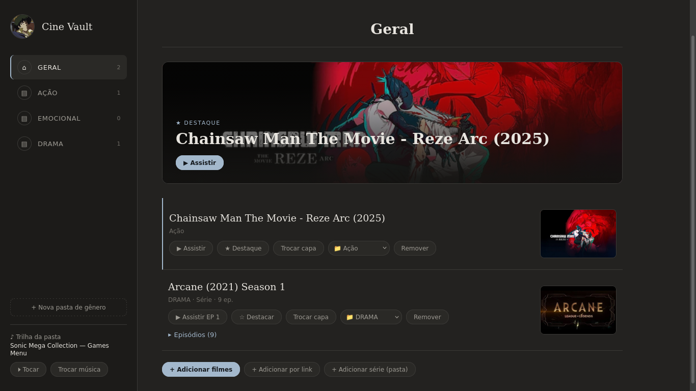

# 🎬 Cine Vault

[English](#-english) · [Português](#-português)

---

## 🇬🇧 English

Cine Vault is a small personal movie and series organizer. You sort your videos into genre folders (Action, Emotional, etc.), and each folder plays its own background music. It runs in the browser, or as a desktop app on Linux.

### Features

- **Genre folders.** Action and Emotional come ready-made, and you can create more.
- **Background music per folder.** Defaults:
  - Action: Tekken 4 — Jet (Character Select)
  - Emotional: Life Is Strange — End Credits (Max & Chloe)
  - General (all movies): Sonic Mega Collection — Games Menu
- **Change the music.** Use "Trocar música" to pick any audio file for the current folder.
- **Add movies** from video files on your computer, or by direct link (`.mp4`, `.webm`...).
- **Series.** "Adicionar série (pasta)" reads a whole folder, including subfolders (seasons), and creates one series with all episodes in natural order (`ep2` before `ep10`). It remembers the last episode you watched, auto-plays the next one, and has Previous/Next buttons.
- **Custom covers.** Change the cover of any movie or series. If a series folder has an image named `cover`, `folder`, `poster` or `capa`, it is used automatically.
- **Highlight.** Mark one movie with ☆ and it appears as a big banner at the top.
- **Move between folders** with the 📁 selector on each item.
- **Search** by title.
- **Chromecast button** in the player (see limitations below).
- **Storage meter** in the top bar, and automatic cleanup of leftover files.


### Project structure

```
CineVault/
├── web/
│   ├── index.html          # the app
│   ├── style.css           # look and feel
│   ├── app.js              # logic
│   └── assets/
│       ├── logo.jpg
│       └── music/          # sonic.mp3, tekken.mp3, life.mp3
├── electron/main.js        # desktop wrapper
├── package.json
├── abrir.sh                # open in Chrome/Chromium app window
├── instalar_atalho.sh      # add a launcher to the app menu
└── gerar_executavel.sh     # build AppImage + .deb
```

### How to run (Linux)

**Quick way** (Chromecast works here):

```bash
chmod +x *.sh
./abrir.sh
```

It opens `web/index.html` as an app window in Chrome, Chromium, Brave or Edge. You can also just open `web/index.html` in your browser.

**App menu shortcut:**

```bash
./instalar_atalho.sh
```

**Build an executable** (needs Node.js, npm and internet the first time):

```bash
./gerar_executavel.sh
chmod +x dist/*.AppImage
./dist/*.AppImage
```

This creates an `.AppImage` and a `.deb` in `dist/`.

### Limitations

- **Chromecast:**
  - It only works in Chrome/Chromium (use `abrir.sh`). The Electron build (AppImage/.deb) has no native Cast.
  - Chrome usually cannot send a local file straight to a Chromecast. If the 📡 button warns about this, use Chrome's menu → **Save and share → Cast** to cast the tab, or add the movie by direct link.
- **Storage:** movies, covers and music are kept inside the browser (IndexedDB). They stay on the device and browser/app you used. Chrome, the AppImage and any hosted copy each have separate libraries. Clearing browser data deletes them. Large series use a lot of space.
- **Video formats:** the browser decides what plays. `.mp4` and `.webm` are the safest. `.mkv` and `.avi` depend on the codec and may not play in Chrome.
- **Progress:** only the last episode is saved, not the minute.
- **Background music:** browsers only allow sound after your first click on the page.

### Troubleshooting

- **It stopped adding movies or series:** look at the storage meter in the top bar. If it is near the limit, remove items you no longer need (removing now frees the space) or use a larger disk. On startup, the app cleans files left over from old removals.
- **Scripts won't run:** run `chmod +x *.sh` inside the folder.
- **`gerar_executavel.sh` fails:** check that `node` and `npm` are installed and that you have internet access, then send the error message.

---

## 🇧🇷 Português

O Cine Vault é um organizador pessoal de filmes e séries. Você separa seus vídeos em pastas por gênero (Ação, Emocional etc.) e cada pasta toca a própria música de fundo. Roda no navegador ou como aplicativo de desktop no Linux.

### Recursos

- **Pastas por gênero.** Ação e Emocional já vêm criadas, e você pode criar outras.
- **Música de fundo por pasta.** Padrões:
  - Ação: Tekken 4 — Jet (Character Select)
  - Emocional: Life Is Strange — End Credits (Max & Chloe)
  - Geral (todos os filmes): Sonic Mega Collection — Games Menu
- **Trocar a música.** O botão "Trocar música" permite escolher qualquer arquivo de áudio para a pasta atual.
- **Adicionar filmes** a partir de arquivos de vídeo do computador ou por link direto (`.mp4`, `.webm`...).
- **Séries.** "Adicionar série (pasta)" lê uma pasta inteira, inclusive subpastas (temporadas), e cria uma série com todos os episódios em ordem natural (`ep2` antes de `ep10`). Ele lembra o último episódio assistido, toca o próximo automaticamente e tem botões Anterior/Próximo.
- **Capas personalizadas.** Troque a capa de qualquer filme ou série. Se a pasta da série tiver uma imagem chamada `cover`, `folder`, `poster` ou `capa`, ela é usada automaticamente.
- **Destaque.** Marque um filme com ☆ e ele aparece como banner grande no topo.
- **Mover entre pastas** com o seletor 📁 de cada item.
- **Busca** por título.
- **Botão de Chromecast** no player (veja as limitações abaixo).
- **Medidor de espaço** na barra de cima e limpeza automática de arquivos que sobraram.

### Estrutura do projeto

```
CineVault/
├── web/
│   ├── index.html          # o programa
│   ├── style.css           # visual
│   ├── app.js              # lógica
│   └── assets/
│       ├── logo.jpg
│       └── music/          # sonic.mp3, tekken.mp3, life.mp3
├── electron/main.js        # empacotador de desktop
├── package.json
├── abrir.sh                # abre em janela de app no Chrome/Chromium
├── instalar_atalho.sh      # cria atalho no menu de aplicativos
└── gerar_executavel.sh     # gera AppImage + .deb
```

### Como usar (Linux)

**Jeito rápido** (o Chromecast funciona aqui):

```bash
chmod +x *.sh
./abrir.sh
```

Ele abre o `web/index.html` como janela de app no Chrome, Chromium, Brave ou Edge. Você também pode simplesmente abrir o `web/index.html` no navegador.

**Atalho no menu de aplicativos:**

```bash
./instalar_atalho.sh
```

**Gerar um executável** (precisa de Node.js, npm e internet na primeira vez):

```bash
./gerar_executavel.sh
chmod +x dist/*.AppImage
./dist/*.AppImage
```

Isso cria um `.AppImage` e um `.deb` na pasta `dist/`.

### Limitações

- **Chromecast:**
  - Só funciona no Chrome/Chromium (use o `abrir.sh`). A versão Electron (AppImage/.deb) não tem Cast nativo.
  - O Chrome normalmente não consegue enviar um arquivo local direto para o Chromecast. Se o botão 📡 avisar isso, use o menu do Chrome → **Salvar e compartilhar → Transmitir** para transmitir a aba, ou adicione o filme por link direto.
- **Armazenamento:** filmes, capas e músicas ficam guardados dentro do navegador (IndexedDB). Eles ficam no aparelho e no navegador/app que você usou. O Chrome, o AppImage e qualquer cópia hospedada têm bibliotecas separadas. Limpar os dados do navegador apaga tudo. Séries grandes ocupam muito espaço.
- **Formatos de vídeo:** quem decide o que toca é o navegador. `.mp4` e `.webm` são os mais seguros. `.mkv` e `.avi` dependem do codec e podem não tocar no Chrome.
- **Progresso:** só o último episódio é salvo, não o minuto.
- **Música de fundo:** os navegadores só liberam o som depois do seu primeiro clique na página.

### Solução de problemas

- **Parou de adicionar filmes ou séries:** olhe o medidor de espaço na barra de cima. Se estiver perto do limite, remova o que não precisa mais (remover agora libera o espaço) ou use um disco com mais espaço livre. Ao abrir, o programa limpa os arquivos que sobraram de remoções antigas.
- **Os scripts não rodam:** execute `chmod +x *.sh` dentro da pasta.
- **`gerar_executavel.sh` dá erro:** confira se `node` e `npm` estão instalados e se há internet, e me mande a mensagem de erro.
